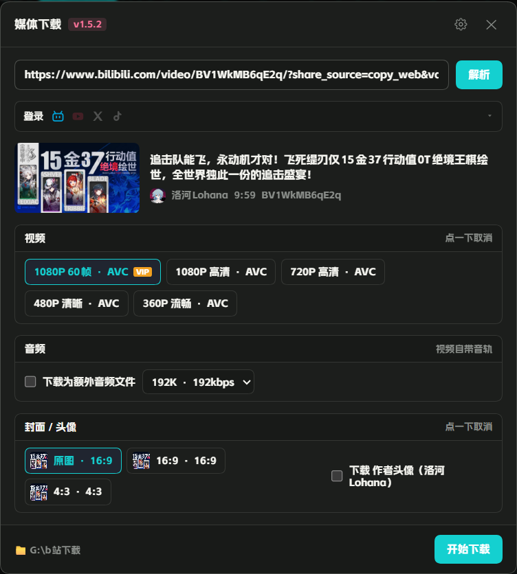

# 媒体下载 · dsh-media

**给 DeepSeek Harness 的多平台下载插件：粘一条链接，弹出选择器，视频、图片、封面、头像按需勾。**

B 站、抖音、小红书各有一套**原生解析器**，不依赖 yt-dlp 的站点适配；
其余站点仍走 yt-dlp，所以覆盖面不缩水。

> **抖音和小红书不需要登录**。B 站高清、YouTube 会员内容才需要。

[](./package.json)
[](./LICENSE)
[](#)
[](./package.json)



> 中文优先。English readers: see [English](#english) at the bottom.

---

## 为什么用它

官方界面本身没有下载能力，而网页版 B 站匿名只给 480P、抖音和小红书又各有一套风控。
这个插件做的是把这些差异藏起来——**你只负责粘链接，剩下的按平台自动选对路子**：

- **一个输入口**：面板图标、输入框、页面任意位置粘贴，三种方式都能唤起
- **该有的都能勾**：视频画质、独立音轨（含转 MP3）、封面（多比例）、图文图片（多张）、作者头像
- **不需要登录就别让你登录**：抖音签匿名 `ttwid`、小红书用链接自带的 `xsec_token`
- **登录不污染日常浏览器**：独立 profile，cookie 只写进 `~/.dsh/bili-dl/`

---

## 支持的东西

| 平台 | 视频 | 图片 | 封面 | 作者头像 | 解析需要登录 |
|---|---|---|---|---|---|
| B 站 | 多画质 / 多编码 | — | 原图 + 16:9 + 4:3 | ✅ | 高清需要（匿名封顶 480P） |
| 抖音 | 无水印 | 图文多张 | ✅ | ✅ | 否 |
| 小红书 | H.264 / H.265 多档 | 图文原图 | ✅ | ✅ | 否 |
| YouTube | 由 yt-dlp 决定 | — | ✅ | ✅ | 会员/年龄限制内容需要 |
| X | 由 yt-dlp 决定 | — | ✅ | ✅ | 受保护账号需要 |
| TikTok | 由 yt-dlp 决定 | — | ✅ | ✅ | 部分视频需要 |
| 其它 | yt-dlp 支持的站点均可 | — | ✅ | — | 视站点而定 |

音频：B 站可单独下（多码率 / 转 MP3）；视频一律自带音轨。

---

## 安装

这是 DSH 插件，不是独立程序。

```bash
git clone https://github.com/lohana20061023-29/dsh-media-downloader.git
```

然后在 DSH 里挂成本地链接：

```bash
plugin_manager install_bundle target="link:/path/to/dsh-media-downloader"
```

包名 `dsh-media-downloader`（仓库名是 `dsh-media-downloader`，两者不同属正常），宿主入口 `index.js`，客户端入口 `client.js`。

依赖：

- **ffmpeg** — 合流与转码。优先用 PATH 里的，找不到会回退到内置候选路径。
- **yt-dlp** — 非原生平台。首次使用会自动下载到 `~/.dsh/bili-dl/bin/`。
- 系统代理会被自动识别（Windows「Internet 选项」），也可在面板里改。

---

## 更新与卸载

**更新**：拉取新版本后，在 DSH 里重新挂载一次即可，插件不写自己的安装目录。

```bash
cd <插件目录> && git pull
plugin_manager install_bundle target="link:<插件目录>"
```

**卸载**：

```bash
plugin_manager remove_bundle target="dsh-media-downloader"
```

下载记录、cookie、登录态都放在 `~/.dsh/bili-dl/`，**卸载不会删除**。要彻底清干净就删掉这个目录。

---

## 使用

**面板**：点输入框旁的小图标，或直接在页面任意位置粘贴链接（自动弹出）。

**工具调用**（给 Agent 用）：

```json
{ "url": "https://www.bilibili.com/video/BV...", "quality": "1080" }
```

工具名 `media_fetch`，返回落地文件的绝对路径。

---

## 三个原生引擎怎么工作

| 平台 | 入口 | 关键点 |
|---|---|---|
| B 站 | 官方 web API + WBI 签名 | `x/player/wbi/playurl` 取 DASH 流，ffmpeg `-c copy` 合流 |
| 抖音 | 移动端分享页 SSR | `_ROUTER_DATA` → `play_addr`，`/playwm/` 改 `/play/` 去水印；只需匿名 `ttwid` |
| 小红书 | 移动端分享页 SSR | `__INITIAL_STATE__` → `noteData.data.noteData`；靠链接里的 `xsec_token`，不需要登录 |

登录窗口是独立 profile 的浏览器实例，登录态只写进 `~/.dsh/bili-dl/`，不碰日常浏览器的数据。

---

## 已知限制

- **B 站**匿名最高 480P，高清必须登录。
- **B 站封面**：4:3 那张是平台单独存放的 `cover43` 素材，只能通过创作中心接口取到，
  而该接口**只对当前登录账号自己的稿件返回数据**——别人的作品拿不到，面板会退回裁切并标注「裁切」。
- 普通稿件的播放页接口只有一张 16:9 原始封面，面板里的「16:9」是它的裁切；
  只有番剧/影视（PGC）才存在多张独立封面，本插件目前只处理普通稿件。
- **小红书**链接必须带 `xsec_token`（App 里「分享 → 复制链接」得到的就有）；只有笔记 ID 时会退回浏览器读取，较慢。
- **抖音**首次解析要签一个匿名 `ttwid`（约 1 秒），之后缓存 7 天。
- 平台改版会让 SSR 字段路径失效，此时会退回 yt-dlp 或直接报错，不会静默返回错误数据。

---

## 兼容性

| 项 | 要求 |
|---|---|
| DSH | Web GUI，需要 `webServer` 与 `tools` 服务 |
| Node | ≥ 18（用到 `AbortSignal.timeout`、原生 fetch） |
| 系统 | Windows 优先；ffmpeg 与 yt-dlp 的自动探测按 Windows 路径写，其它系统需自行装好并加进 PATH |
| 浏览器 | 登录窗口依赖 Edge 或 Chrome |

---

## 合规

仅供个人离线观看/备份使用。请遵守各平台的服务条款与当地法律，不要用于二次分发或商业用途。

本项目不涉及 DRM 绕过，也不破解加密流；仅使用平台公开下发的页面数据与播放地址。

---

## 目录

```
index.js              宿主：路由注册、工具定义、图片代理
client.js             客户端：面板 UI（受限 React 子集）
lib/bili.mjs          B 站：WBI、probe、下载
lib/douyin.mjs        抖音：SSR 解析 + ttwid 签发
lib/xhs.mjs           小红书：移动端 SSR 解析
lib/ytdlp.mjs         yt-dlp 封装
lib/browser-login.mjs 登录窗口（CDP）
lib/qr.mjs            零依赖二维码编码
docs/架构说明.md       模块划分与数据流
```
---

## 开发

```bash
git clone https://github.com/lohana20061023-29/dsh-media-downloader.git
plugin_manager install_bundle target="link:<克隆目录>"
```

改完 `client.js` 刷新页面即可；改 `index.js` 或 `lib/` 需要重载插件（`remove_bundle` + `install_bundle`）。

**改文件时注意编码**：`client.js` 若带上 UTF-8 BOM，模块会加载失败、界面整个消失且宿主无报错。用编辑器保存为「UTF-8 无 BOM」。

目录职责见 [docs/架构说明.md](./docs/架构说明.md)，发版流程见 [docs/发版流程.md](./docs/发版流程.md)。

---

## 更新日志

见 [CHANGELOG.md](./CHANGELOG.md)。

## 许可

[MIT](LICENSE) © 2026 dsh-media contributors

用、改、再分发都可以，保留版权声明即可。

---

## 赞助

如果这个插件帮你省了时间，可以请我喝杯咖啡。两个码长期有效，金额随意。


## English

**dsh-media-downloader** is a DeepSeek Harness plugin that downloads media from Bilibili, Douyin (TikTok China), Xiaohongshu (RED) and any site yt-dlp supports.

- **Bilibili** — official web API with WBI signing; up to 4K when logged in, DASH streams remuxed losslessly with ffmpeg
- **Douyin** — share-page SSR; watermark-free video, image posts, covers, author avatars. No login needed (an anonymous `ttwid` is minted automatically)
- **Xiaohongshu** — mobile share page; image posts in original resolution and H.264/H.265 video streams. No login needed (uses the `xsec_token` embedded in the share link)
- **Everything else** — delegated to yt-dlp

Paste a link anywhere in the DSH web UI and a picker appears. Pick video quality, audio track, cover ratio, images or the author avatar; files land in your configured folder.

Install: `plugin_manager install_bundle target="link:/path/to/repo"`.
Agents can call the `media_fetch` tool with `{"url": "...", "quality": "1080"}`.

License: MIT.
